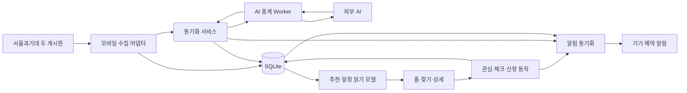

# 서울과기대 맞춤 공지 앱 구현 설계안

- 작성일: 2026-11-13
- 기준 계획: [해커톤 구현 계획](campus_notice_hackathon_plan.md)
- 대상: 서울과학기술대학교 대학공지사항과 컴퓨터공학과 학부 공지사항
- 개발 조건: 3명, 14시간
- 상태: 구현을 위한 제안. 모바일 기기·AI 계정·배포 환경은 아직 미정

**Expo 모바일 앱이 공개 공지를 수집하고, AI 중계 함수가 공지를 구조화하며, SQLite가 공지와 사용자의 신청 진행 상태를 보관한다.** 화면은 홈과 공지 찾기 두 탭으로 구성한다. 개발의 첫 목표는 실제 공지 한 건이 수집부터 관심 저장, 준비물 확인, 일정·알림까지 이어지는 것이다.

구현에서 가장 중요한 경계는 **수집한 최신 원문, 마지막으로 성공한 AI 분석, 사용자가 체크한 작업 기록**을 분리하는 것이다. 공지가 수정되거나 AI가 실패해도 사용자 기록을 유지하고, 과거 마감을 최신 정보처럼 보여주지 않는다.

## 1 구현 기본안

| 영역 | 선택 | 적용 방식 |
| --- | --- | --- |
| 우선 기기 | Android 실기기 1대 | iOS 동시 검증은 필수 범위에서 제외 |
| 앱 | React Native, Expo, TypeScript | 프로젝트 생성 시 호환 버전을 고정하고 lockfile 공유 |
| 화면 이동 | Expo Router | 온보딩, 홈·찾기 탭, 공통 상세, 설정 |
| 영속 저장 | expo-sqlite | 공지와 사용자 상태의 유일한 영속 원본 |
| 화면 상태 | React Context와 화면별 state | DB 변경 후 읽기 모델 갱신. 별도 영속 store 중복 도입 생략 |
| HTML 분석 | htmlparser2와 css-select | 게시판별 선택자로 본문을 찾고 공통 정제 함수 사용 |
| 입력·응답 검증 | Zod | 모바일·중계가 같은 계약 파일 사용 |
| 날짜 | Day.js의 UTC·Timezone 플러그인 | Asia/Seoul 기준 계산을 한 모듈로 모음 |
| 알림 | expo-notifications | 신청 마감 전날 오전 9시의 로컬 알림 한 종류 |
| 중계 기본안 | Cloudflare Worker 1개 | POST /analyze-notice, 비밀 설정과 호출 제한 binding 사용 |
| AI 기본안 | Gemini의 구조화 출력 지원 모델 1개 | 계정에서 호출 가능한 모델을 검증해 서버 설정에 고정 |
| 테스트 | 순수 로직 테스트와 실기기 시나리오 | 추천·날짜·변경 보존 규칙에 집중 |

팀이 이미 사용하는 서버 함수 환경이 있으면 중계 배포만 교체한다. 모델명이나 SDK 최신 번호를 설계에 고정하기보다, 첫 실제 요청이 성공한 조합을 프로젝트 설정에 고정한다.

네이티브 React Native 요청에는 브라우저의 CORS 모델이 적용되지 않는다. 따라서 웹 미리보기의 요청 성공 여부를 모바일 수집의 판정 기준으로 사용하지 않는다. HTTPS 접근과 게시판 제한은 별도로 확인한다. [React Native 네트워크 문서](https://reactnative.dev/docs/network)

HTML 파서와 선택자 엔진의 조합은 후보이며, Metro 번들링과 실기기 실행을 첫 1시간에 검증한다. Node 전용 stream API는 사용하지 않는다. [htmlparser2](https://github.com/fb55/htmlparser2), [css-select](https://github.com/fb55/css-select)

## 2 실제 게시판에 맞춘 수집 설계

### 2.1 수집 대상

| 출처 ID | 목록 URL | 게시판 번호 | 상세 조회 방식 |
| --- | --- | --- | --- |
| seoultech_general | https://www.seoultech.ac.kr/service/info/notice | bnum=4691 | do=commonview, bidx=게시물 ID |
| seoultech_cs | https://computer.seoultech.ac.kr/info/notice | bnum=58476 | do=view, bidx=게시물 ID |

2026-11-13에 두 목록과 상세 각 한 건의 공개 HTML을 HTTP 요청으로 확인했다. 두 사이트 모두 UTF-8 HTML에 목록 링크와 본문 텍스트가 포함되어 있었다. 이는 데스크톱 환경의 확인 결과이며, Android의 fetch·파서 조합은 초기 구현에서 검증한다. [대학공지사항](https://www.seoultech.ac.kr/service/info/notice), [컴퓨터공학과 학부 공지사항](https://computer.seoultech.ac.kr/info/notice)

본교의 학사공지와 장학공지는 각각 별도 게시판이다. **현재 두 출처만으로 학교 전체의 학사·장학 공지를 모두 수집한다고 표시하면 안 된다.** 두 출처 연결 후 여력이 있으면 같은 어댑터 설정을 확장한다. [학사공지](https://www.seoultech.ac.kr/service/info/matters), [장학공지](https://www.seoultech.ac.kr/service/info/janghak)

### 2.2 확인한 HTML 선택자

| 항목 | 대학공지사항 | 컴퓨터공학과 학부 공지사항 |
| --- | --- | --- |
| 목록 행 | .wrap_list .tbl_list tbody tr.body_tr | .board_container table.board tbody tr.body_tr |
| 상세 링크 | 행 내부 a[href] 중 do=commonview와 bidx 포함 | 행 내부 a[href] 중 do=view와 bidx 포함 |
| 일반 행 제목 | td.tit a | td.body_col_title.dn2 a |
| 상세 표 | .wrap_view table.tbl_view | .board_container .wrap_cont table.tbl_list |
| 상세 본문 | .wrap_view .tbl_view td.cont | .board_container .wrap_cont .tbl_list td.cont |
| 첨부 영역 | .list_attach | 상세 표의 td.file |

제목·작성일은 상세 표에서 `th`의 텍스트를 읽고 바로 다음 `td`를 찾는다. 표의 열 순서가 서로 다르므로 고정된 열 번호를 공용으로 사용하지 않는다. 목록의 상단 강조 공지는 링크 문구가 제목 대신 ‘더보기’일 수 있어 상세 페이지의 제목으로 보정한다.

페이지 이동 스크립트는 `frmSearch`의 GET 요청에 `page`와 `size`를 넣는다. 확인한 기본 일반 게시물 수는 본교 15개, 학과 6개이며 고정 공지가 추가된다. **상세 링크의 nowpage를 다음 목록 페이지 주소로 오해하지 않는다.** 목록 폼의 숨김 필드를 유지하고 `page`를 변경하는 방식으로 구현한 뒤, 2페이지의 게시물 ID가 달라지는지 검증한다.

초기에는 1페이지만 수집한다. 전체 흐름이 연결되면 출처당 최대 30개까지, 최대 5페이지 안에서 확장한다. 고정 공지는 페이지마다 중복될 수 있으므로 개수를 세기 전에 ID로 중복 제거한다.

### 2.3 어댑터 계약

```ts
interface BoardAdapter {
  sourceId: 'seoultech_general' | 'seoultech_cs';
  listUrl: string;
  buildListUrl(page: number): string;
  parseList(html: string, responseUrl: string): NoticeRef[];
  parseDetail(html: string, ref: NoticeRef): CollectedNotice;
}

interface NoticeRef {
  id: string;               // seoultech_cs:58476:897737
  sourceId: BoardAdapter['sourceId'];
  boardId: string;          // bnum
  postId: string;           // bidx
  sourceUrl: string;        // 검증된 상세 조회 URL
  title: string;
  publishedDate: string | null;
}

interface CollectedNotice extends NoticeRef {
  bodyText: string;
  extractedLinks: Array<{ label: string; url: string }>;
  attachments: Array<{ name: string; url: string | null }>;
  hasBodyImages: boolean;
  sourceUpdatedAt: string | null;
  fetchedAt: string;
  contentHash: string;
}
```

게시물 ID는 `sourceId:bnum:bidx`로 만든다. 조회수, 목록 순서, 제목은 ID에 사용하지 않는다. 상세 요청은 실제 링크를 기반으로 하며, `searchtext`, `searchtype`, 중복 `nowpage` 등 검색·페이지 상태는 식별 키에서 제외한다. 원문 URL에서 기능에 필요한 파라미터는 확인 없이 일괄 삭제하지 않는다.

본문 정제는 다음 순서로 구현한다.

1. 상세 표와 본문 셀이 존재하는지 확인한다. 없으면 로그인·오류 화면 또는 구조 변경으로 처리한다.
2. 본문 영역의 script·style을 제거하고, p·br·li·표 행은 줄바꿈, 표의 셀은 구분자로 바꾼다.
3. HTML entity와 공백을 정리하되 숫자·문장부호·문단 관계를 유지한다.
4. 본문 내부의 실제 href와 텍스트 URL을 수집하고 상대 URL을 절대 URL로 변환한다.
5. 첨부파일명·직접 링크 유무, 본문 이미지 존재 여부를 별도 기록한다.
6. 제목·본문·링크·첨부 메타데이터를 정규화해 SHA-256 해시를 계산한다.

전체 HTML이나 조회수·수집 시각은 해시에 포함하지 않는다. 링크는 정규화 후 정렬해 직렬화하고, 정규화 규칙에 버전을 둔다. 본문이 너무 길면 뒤를 조용히 잘라 분석하지 않고 ‘본문 길이 초과·원문 확인 필요’로 남긴다.

### 2.4 첨부와 이미지 처리

확인한 학과 공지의 PDF 다운로드 링크는 `javascript:downloadfile(...)` 형태였다. MVP에서는 해당 스크립트를 실행하거나 다운로드 주소를 추측하지 않는다. 첨부파일명과 `url: null`을 저장하고 공지 원문으로 연결한다. **직접 URL을 못 얻었다는 이유로 ‘첨부 없음’으로 처리하지 않는다.** [확인한 학과 공지](https://computer.seoultech.ac.kr/info/notice?do=view&bnum=58476&bidx=897737)

이미지만 있는 공지는 제목·출처·원문 링크를 제공하고 ‘이미지 내용 확인 필요’로 표시한다. 본문 이미지가 있더라도 텍스트는 분석할 수 있지만, 이미지 내용을 읽었다고 표시하지 않는다. 첨부파일이 같은 URL에서 교체되는 경우는 본문·메타데이터 해시만으로 탐지할 수 없으며 이번 범위에 포함하지 않는다.

## 3 코드 구조와 책임



권장 디렉터리는 아래와 같다. 공통 계약 파일을 앱과 Worker에서 직접 가져오며, 해커톤에서는 별도 공통 패키지 배포 절차를 만들지 않는다.

```text
team15/
  app/                         # Expo Router 화면
    _layout.tsx
    onboarding.tsx
    (tabs)/index.tsx            # 홈
    (tabs)/discover.tsx         # 공지 찾기
    notice/[id].tsx
    settings.tsx
  src/
    components/                # NoticeCard, Checklist, StatusBadge
    features/                  # profile, discover, saved
    domain/                    # eligibility, ranking, dates, changeDetection
    services/                  # sync, noticeActions, reminderReconciler
    sources/                   # adapters, htmlToText, canonicalize
    db/                        # migrations, repositories, dbQueue
    platform/                  # notifications, externalLink, secureStore
  shared/
    contracts.ts               # Zod 계약과 추론한 TypeScript 타입
    canonicalize.ts            # 입력 정규화 규칙
  worker/
    src/index.ts               # HTTP 검증·접근 제한
    src/analyze.ts             # 고정 프롬프트·모델 호출·출력 검증
    wrangler.jsonc
  fixtures/                    # 가상 예시와 실제 수집 예시를 구분
  docs/
```

화면은 SQL, HTML 선택자, AI SDK를 직접 사용하지 않는다. `noticeActions`가 사용자 동작을, `sync`가 수집·분석을 담당한다. 추천·날짜 판정은 네트워크와 DB에 의존하지 않는 순수 함수로 작성한다.

## 4 공통 데이터 계약

원 계획의 출력 계약 1.0을 구현 시 **1.1로 구체화**한다. 변경점은 조건별 ‘제한 없음·특정 대상·미확인’ 구분, 자동 비교가 어려운 복합 조건 표시, 불확실한 일정 보존이다. 아직 운영 데이터가 없으므로 처음부터 한 버전으로 시작한다.

아래는 핵심 타입이다. 실제 구현은 Zod 스키마를 원본으로 두고 타입을 추론한다. AI에 전달할 JSON Schema는 같은 스키마에서 생성하되 모델이 지원하는 항목만 사용한다. 별도의 의미 검증은 서버에서 수행한다. [Zod JSON Schema 변환](https://zod.dev/json-schema)

```ts
type Enrollment = 'enrolled' | 'leave' | 'other';
type Disposition = 'unseen' | 'saved' | 'dismissed';
type Progress = 'saved' | 'preparing' | 'applied';
type BasicResult = 'basic_match' | 'mismatch' | 'needs_review';

interface Profile {
  universityId: 'seoultech';
  department: string;           // 기본값 컴퓨터공학과
  grade: 1 | 2 | 3 | 4 | 5;    // 5는 5학년 이상
  enrollment: Enrollment;
  keywords: string[];
}

interface Scope<T> {
  mode: 'all' | 'specific' | 'unknown';
  values: T[];                  // specific이면 1개 이상, 나머지는 []
  evidence: string | null;      // all/specific이면 원문 근거 필수
}

type EventType =
  | 'application_open' | 'application_close' | 'document_deadline'
  | 'event_start' | 'event_end' | 'result_announcement';

interface ExtractedEvent {
  type: EventType;
  label: string;                // 신청 마감, 1차 모집 마감 등
  status: 'resolved' | 'needs_review';
  date: string | null;          // YYYY-MM-DD
  time: string | null;          // HH:mm
  timezone: string | null;
  precision: 'date' | 'datetime' | 'unknown';
  evidence: string;
}

interface NoticeAnalysis {
  summary: string;
  tags: string[];
  benefits: string[];
  activity: {
    period_text: string | null;
    frequency_text: string | null;
    location_text: string | null;
    evidence: string;
  } | null;
  eligibility: {
    comparison: 'all_of' | 'manual_review';
    departments: Scope<string>;
    grades: Scope<number>;
    enrollments: Scope<Enrollment>;
    other_conditions: string[];
  };
  events: ExtractedEvent[];
  checklist: Array<{ text: string; evidence: string }>;
  application_url: string | null;
  review_notes: string[];
}

interface AnalysisEnvelope {
  notice_id: string;
  content_hash: string;
  schema_version: '1.1';
  extractor_version: string;    // 프롬프트·모델 설정 버전. 초기값 e1
  analyzed_at: string;          // UTC ISO 8601
  data: NoticeAnalysis;
}
```

`all`은 원문에 제한이 없다는 근거가 있을 때만 사용한다. 조건이 기재되지 않았다면 `unknown`이다. 여러 모집 대상이나 ‘A 또는 B’ 조건을 단순한 AND로 비교할 수 없다면 `manual_review`로 두어 자동 제외를 피한다.

`resolved` 일정은 유효한 날짜와 시간대가 필수다. `precision=date`이면 시각은 null, `datetime`이면 시각이 필요하다. 연도가 불명확하거나 날짜가 충돌하거나 처리하지 못하는 시간대이면 `needs_review`로 두고 자동 일정·알림에 사용하지 않는다.

API 필드는 snake_case, 모바일 내부 필드는 camelCase를 사용한다. 경계에서 한 번만 변환하고 화면마다 변환 규칙을 만들지 않는다.

## 5 SQLite 저장 설계

### 5.1 여섯 개의 테이블

| 테이블 | 주요 열 | 제약과 역할 |
| --- | --- | --- |
| profile | id=1, department, grade, enrollment, keywords_json, updated_at | 단일 사용자 |
| notices | id, source_id, board_id, post_id, source_url, title, raw_json, content_hash, fetched_at, published_date, analysis_json, analyzed_content_hash, schema_version, extractor_version, analyzed_at, analysis_status, last_error | UNIQUE(source_id, board_id, post_id). 원문과 마지막 성공 분석을 별도 갱신 |
| user_notices | notice_id, disposition, progress, saved_at, updated_at, checklist_initialized, checklist_snapshot_hash, deadline_baseline_hash | notice_id가 PK이자 FK. 저장 이력이 없으면 progress는 null |
| checklist_items | id, notice_id, text, evidence, completed, created_at | id는 UUID. 최초 생성 후 배열 순서와 무관하게 유지 |
| reminders | reminder_key, notice_id, desired_fire_at, applied_fire_at, os_identifier, state, last_error | reminder_key가 PK. OS와의 동기화 상태 보관 |
| sync_state | source_id, last_attempt_at, last_success_at, last_error, detail_failures | 출처별 수집 결과. AI 분석 결과와 분리 |

`raw_json`에는 본문, 본문 링크, 첨부 메타데이터, 이미지 존재 여부를 넣는다. `analysis_json`은 마지막 정상 AnalysisEnvelope를 보관한다. 일정은 이 JSON에서 계산하고, MVP에서는 달력 전용 테이블을 만들지 않는다. SQLite 데이터는 앱 재시작 후에도 유지된다. [Expo SQLite](https://docs.expo.dev/versions/latest/sdk/sqlite/)

### 5.2 필수 제약과 쓰기 처리

```sql
CREATE TABLE user_notices (
  notice_id TEXT PRIMARY KEY REFERENCES notices(id),
  disposition TEXT NOT NULL DEFAULT 'unseen'
    CHECK(disposition IN ('unseen', 'saved', 'dismissed')),
  progress TEXT CHECK(progress IN ('saved', 'preparing', 'applied')),
  saved_at TEXT,
  updated_at TEXT NOT NULL,
  checklist_initialized INTEGER NOT NULL DEFAULT 0
    CHECK(checklist_initialized IN (0, 1)),
  checklist_snapshot_hash TEXT,
  deadline_baseline_hash TEXT,
  CHECK(disposition <> 'saved' OR progress IS NOT NULL)
);

CREATE TABLE checklist_items (
  id TEXT PRIMARY KEY,
  notice_id TEXT NOT NULL REFERENCES user_notices(notice_id),
  text TEXT NOT NULL,
  evidence TEXT NOT NULL,
  completed INTEGER NOT NULL DEFAULT 0 CHECK(completed IN (0, 1)),
  created_at TEXT NOT NULL
);

CREATE INDEX idx_user_notices_disposition ON user_notices(disposition);
CREATE UNIQUE INDEX idx_notices_source_post
  ON notices(source_id, board_id, post_id);
```

위 SQL은 주요 제약의 예시이며 `notices` 테이블을 만든 뒤 실행한다. 사용자 입력은 SQL 파라미터로 전달하고, 갱신에는 `INSERT ... ON CONFLICT DO UPDATE`를 사용한다. 기존 행 삭제가 일어나는 `REPLACE`를 피하여 사용자 기록을 보존한다.

DB 연결 시 WAL·foreign_keys를 켜고 `user_version`으로 migration을 관리한다. MVP에서는 단일 연결의 모든 접근을 `dbQueue`에 통과시켜 짧은 트랜잭션을 순서대로 실행한다. 네트워크·OS 알림 API는 트랜잭션 밖에서 호출한다. 비동기 트랜잭션에 다른 작업이 섞이지 않도록 repository 외부에서 DB 연결을 직접 사용하지 않는다. [Expo SQLite 트랜잭션 주의점](https://docs.expo.dev/versions/latest/sdk/sqlite/)

### 5.3 분석의 최신 여부

`analysis_status`는 `pending / running / ready / failed / unsupported`로 구분한다. 최신 분석인지 여부는 다음 조건으로 계산한다.

```text
fresh = 정상 분석이 존재함
        AND content_hash == analyzed_content_hash
        AND schema_version == 앱이 지원하는 버전
        AND extractor_version == 현재 추출 설정 버전
```

분석 실패 시 과거의 성공 결과를 삭제하지 않는다. 다만 fresh가 아니면 이전 요약·날짜에 ‘이전 분석·업데이트 확인 중’을 표시하고 확정 일정과 자동 알림에는 사용하지 않는다. 분석 도중 종료된 앱은 다음 실행에서 남은 `running`을 `pending`으로 되돌린다.

## 6 수집과 분석의 실행 순서

### 6.1 갱신 정책

아래 수치는 플랫폼 보장값이 아닌 MVP 시작 설정이다. 첫 실제 호출의 응답 시간과 AI 계정 제한에 맞춰 조정한다.

| 항목 | 시작 설정 |
| --- | --- |
| 자동 갱신 판단 | 앱 시작·포그라운드 복귀 시 마지막 시도에서 30분 경과 |
| 수동 갱신 | 마지막 시도에서 30초 경과, 이미 진행 중이면 같은 작업 사용 |
| 상세 페이지 동시 요청 | 전체 2개 이하 |
| AI 동시 요청 | 1개 |
| HTML 요청 제한 시간 | 10초 |
| AI 중계의 모델 호출 제한 시간 | 25초 |
| 모바일의 중계 요청 제한 시간 | 35초 |
| 한 갱신의 자동 AI 분석량 | 최대 10건. 나머지는 미분석으로 보관 |
| 자동 재시도 | 기본 없음. 다음 갱신 또는 사용자가 재시도 |

60개를 수집하더라도 60개 AI 호출이 끝날 때까지 화면을 막지 않는다. 우선 저장한 공지의 변경분, 사용자가 연 상세, 새로운 제목이 관심 키워드와 맞는 공지 순서로 분석한다. 분석 실패에도 제목·원문 보기·관심 저장은 가능하다. 계정 제한에 도달하면 분석 큐를 멈추고 다음 허용 시각을 표시한다.

### 6.2 처리 단계

1. DB에서 프로필·공지·사용자 진행을 읽어 화면을 먼저 표시한다.
2. 기존 알림을 기기의 예약 목록과 맞춘다. 갱신 중인 작업이 있으면 중복 실행하지 않는다.
3. 두 목록을 출처별로 수집한다. 한 출처가 실패해도 다른 출처 처리를 계속한다.
4. 최신 목록과 저장한 진행 중 공지를 합쳐 상세 수집 대상을 만든다. 저장한 공지가 목록 밖으로 밀려도 다시 확인한다.
5. 본문을 파싱하고 정규화 해시를 계산한 뒤 원문만 UPSERT한다.
6. 해시가 달라졌다면 기존 분석을 과거 결과로 취급하고 해당 공지의 마감 알림 중지를 먼저 요청한다.
7. 최신 분석을 재사용할 수 없으면 AI 큐에 넣는다. 네트워크 대기는 DB 트랜잭션 밖에서 한다.
8. 응답의 ID·해시·버전·스키마를 검증한다. 응답을 기다리는 동안 본문이 또 바뀌었다면 그 응답을 현재 분석으로 반영하지 않는다.
9. 성공 분석과 `analyzed_content_hash`를 같은 트랜잭션에서 갱신한다. 이미 생성한 체크 항목은 변경하지 않는다.
10. 추천·일정 읽기 모델을 새로 계산하고 저장한 공지의 알림을 맞춘다.

응답 적용 조건은 `현재 content_hash == 요청할 때의 해시 == 응답 content_hash`다. 조건이 다르면 폐기하고 최신 본문이 다음 분석 대상에 남도록 한다. 늦게 도착한 응답이 새 내용을 덮는 일을 막는다.

상세 한 건이 실패하면 그 건의 기존 데이터는 보존한다. 출처의 일부만 성공했을 때는 `last_attempt_at`과 실패 건수를 갱신하고, 전체 성공처럼 `last_success_at`을 덮지 않는다. 목록에 없다는 이유로 저장한 공지를 삭제하지 않는다. 단순 통신 실패만 발생했다면 마지막으로 확인한 일정은 유지하고 마지막 확인 시각을 보여준다.

## 7 AI 중계 API

### 7.1 요청과 응답

`POST /analyze-notice` 한 경로를 제공한다. 아래 요청은 형식을 설명하는 가상 데이터다.

```json
{
  "notice_id": "demo:1",
  "content_hash": "실제 요청에서는 정규화 입력의 SHA-256 64자리 hex",
  "schema_version": "1.1",
  "extractor_version": "e1",
  "title": "시연용 참가자 모집",
  "body_text": "신청 마감은 2026년 11월 20일 18시입니다. 제출 서류는 참가 신청서입니다.",
  "source_url": "https://example.invalid/notices/1",
  "extracted_links": [],
  "attachments": [],
  "has_body_images": false
}
```

성공 응답은 4절의 `AnalysisEnvelope`다. 봉투의 ID·해시·버전·분석 시각은 서버 코드가 채우며 모델이 결정하지 않는다. 서버는 정규화 입력의 해시를 다시 계산해 비교한다. 프로필·학번·사용자의 체크 기록은 요청에 넣지 않는다.

`attachments`는 `{ name, url: string | null }[]`이다. 해시는 제목·본문·본문 링크·첨부 메타데이터·이미지 존재 여부와 정규화 버전을 대상으로 한다. `notice_id`, `source_url`, 호출 시각은 분석 내용의 해시에서 제외한다. 본문을 실제 학교에서 가져왔는지는 이 해시만으로 인증되지 않는다.

### 7.2 서버 처리와 출력 검증

1. 경로·POST·JSON 여부, 시연 접근 토큰과 만료를 확인한다.
2. 실제 요청 바이트를 읽으며 최대 128 KiB로 제한한다. Content-Length만 신뢰하지 않는다.
3. 본문 최대 20,000자, 링크·첨부 각각 최대 30개를 검증한다. 초과 입력은 413으로 반환한다.
4. 모델·시스템 지침·출력 스키마를 서버 설정으로 고정해 호출한다.
5. JSON 구조 검증 후 날짜·근거·URL·필드 조합을 검증한다.
6. 검증된 결과만 반환한다. 원문은 모델의 지시가 아니라 추출 대상 데이터로 전달한다.

Gemini 구조화 출력은 JSON Schema에 맞춘 결과 생성에 사용할 수 있다. 스키마 적합성은 내용의 사실성을 보장하지 않으므로 아래 검증을 추가한다. [Gemini 구조화 출력](https://ai.google.dev/gemini-api/docs/structured-output)

| 검증 | 처리 |
| --- | --- |
| 2월 30일 등 불가능한 날짜 | 정상 결과로 수용하지 않음 |
| 근거가 정규화 원문에 존재하지 않음 | 해당 필드를 미확인으로 낮추고 review_notes에 사유 추가 |
| 연도 근거가 없음 | 게시일·현재 연도로 보충하지 않고 needs_review |
| 원문에 시간 없음 | time=null, precision=date |
| 신청 URL이 입력 링크·본문 URL에 없음 | application_url=null |
| URL이 javascript·data 등 실행 스킴 | 외부 열기 대상으로 허용하지 않음 |
| 복수 마감의 의미가 불명확하거나 서로 충돌 | 일정 후보는 보존하되 자동 예약 제외 |
| 첨부·이미지의 내용을 확인하지 못함 | 미확인 안내 유지, 필수 서류를 창작하지 않음 |

날짜 근거에 연도가 다른 문장으로 명시돼 있다면 그 연결 근거도 포함해야 한다. ‘같은 글이니 아마 같은 연도’만으로 확정하지 않는다. 근거 문자열의 포함 여부는 최소 검증이며 의미 정확성은 실제 공지 표본과 대조한다.

### 7.3 접근과 호출 제한

팀 관리 기기의 시연을 기본 배포 범위로 둔다. 운영자가 만든 시연 토큰을 기기에서 한 번 입력하고 SecureStore에 보관한다. 서버는 토큰의 해시와 만료 시각을 비밀 설정으로 갖는다. 앱 코드·공개 환경변수·저장소에 AI 키나 공용 토큰을 넣지 않는다. [Cloudflare Secrets](https://developers.cloudflare.com/workers/configuration/secrets/), [Expo SecureStore](https://docs.expo.dev/versions/latest/sdk/securestore/)

Worker Rate Limiting binding을 검증한 토큰 ID 기준으로 적용한다. 시작값은 토큰당 60초에 10회이며 실제 AI 계정 한도 이하로 조정한다. 이 제한은 위치별 근사 제한이므로 전 세계 합산 비용의 엄격한 상한으로 설명하지 않는다. 시연 토큰 만료와 서버의 분석 중지 설정도 함께 둔다. [Cloudflare 호출 제한](https://developers.cloudflare.com/workers/runtime-apis/bindings/rate-limit/)

이 방식은 제한된 시연 접근이다. 다수 사용자에게 공개 배포할 때는 기기·사용자별 접근 발급과 전역 사용량 제어를 추가해야 한다. 서버에는 사용자 DB나 수집 큐를 만들지 않는다. 호출 로그는 요청 ID, 공지 ID, 상태, 지연, 토큰 사용량 위주로 남긴다.

### 7.4 오류 계약

오류는 `{ error: { code, retryable, retry_after_seconds }, request_id }` 형식이다.

| HTTP | code | 모바일 처리 |
| --- | --- | --- |
| 400 / 413 | INVALID_INPUT / INPUT_TOO_LARGE | 원문 확인 안내, 같은 입력 자동 재시도 금지 |
| 401 | UNAUTHORIZED | 시연 접근 설정 확인 |
| 409 | CONTRACT_MISMATCH | 앱·서버 계약 버전 확인 |
| 429 | RATE_LIMITED | Retry-After까지 큐 중지 |
| 502 | INVALID_MODEL_OUTPUT | 기존 분석 보존, 수동 재시도 제공 |
| 503 / 504 | PROVIDER_UNAVAILABLE / TIMEOUT | 기존 캐시 표시, 제한된 수동 재시도 |

첫 구현에서는 자동 재시도를 생략해 중복 과금과 반복 호출을 줄인다. 요청 ID는 추적용이며 서버에 결과 저장소가 없는 이 구조에서는 같은 요청의 과금 중복 제거를 보장하지 않는다.

## 8 추천과 지원 조건 판정

### 8.1 조건 비교

`evaluateEligibility(profile, analysis)`는 결과와 사용자에게 보여줄 이유를 함께 반환한다.

1. 분석이 최신이 아니거나 `comparison=manual_review`이면 `needs_review`.
2. 자동 비교 가능한 명시적 필수 조건에서 하나라도 확실히 다르면 `mismatch`.
3. 비교할 수 없는 조건·unknown 항목·기타 조건이 남아 있으면 `needs_review`.
4. 확인한 기본 조건이 모두 맞으면 `basic_match`.

학과 이름은 작은 별칭 사전으로 정규화한다. 예를 들어 컴공과 컴퓨터공학과는 연결하되, 전자공학과·컴퓨터공학과·소프트웨어학과를 임의로 같은 학과로 취급하지 않는다. 5학년 이상 등 범위가 불명확하면 자동 불일치로 처리하지 않는다. 게시판 출처 자체를 지원 대상 근거로 사용하지 않는다.

### 8.2 정렬

확률 점수 대신 아래 우선순위를 순서대로 비교한다.

```text
기본 후보 = 미분류 공지
            - 확실히 종료된 신청 공지
            - 명확한 필수 조건 불일치

정렬 = 관심 키워드 일치 등급 내림차순
       → 확인된 신청 마감 날짜 오름차순
       → 게시일 내림차순
       → 공지 ID
```

키워드 일치 등급은 제목·태그 일치 2, 본문 일치 1, 관련성 미확인 0이다. 키워드는 소문자·공백·중복을 정리하고 직접 입력한 단어도 같은 방식으로 비교한다. 영문 약어는 단어 경계를 고려해 `AI`가 `mail`에 들어 있다는 이유로 일치시키지 않는다. 순위에 사용한 근거로 추천 이유를 생성한다.

분석 전 공지도 제목·본문 키워드로 표시할 수 있다. 이때 조건과 마감은 미확인이다. ‘전체 공지’는 저장·넘김·마감·불일치 필터를 해제하고 현재 분류 상태를 표시한다. 프로필 변경은 로컬 재계산만 수행하며 AI 재호출이나 체크 기록 초기화를 하지 않는다.

## 9 사용자 동작과 체크리스트 보존

### 9.1 화면이 사용하는 공통 함수

```ts
interface NoticeActions {
  saveNotice(noticeId: string): Promise<void>;
  dismissNotice(noticeId: string): Promise<void>;
  unsaveNotice(noticeId: string): Promise<void>;
  setProgress(noticeId: string, progress: Progress): Promise<void>;
  setChecklistCompleted(itemId: string, completed: boolean): Promise<void>;
  acknowledgeDeadlineChange(noticeId: string): Promise<void>;
  refreshNotices(reason: 'launch' | 'foreground' | 'manual'): Promise<void>;
  reconcileReminders(): Promise<void>;
}
```

버튼과 스와이프는 같은 함수를 호출한다. 체크는 `toggle` 대신 최종 boolean을 전달해 중복 실행에 강하게 만든다. UI는 처리 중 버튼을 잠그고 DB 성공 후 반영한다. 알림 예약 실패 때문에 이미 성공한 관심 저장을 되돌리지 않는다.

| 동작 | DB 처리 | 일정·알림 처리 |
| --- | --- | --- |
| 최초 관심 저장 | disposition=saved, progress=saved | 최신 확정 일정 표시, 허용된 알림 예약 |
| 같은 공지 다시 저장 | 기존 progress·체크 항목 재사용 | 기존 예약과 비교해 필요한 차이만 적용 |
| 넘기기 | 미분류 공지를 dismissed로 변경 | 다른 공지·키워드에 영향 없음 |
| 관심 해제 | disposition=unseen, progress·체크 기록 보존 | 홈 일정에서 제외, 예약 취소 |
| 준비 중 | progress=preparing | 현재 마감 알림 유지 |
| 신청 완료 | progress=applied | 신청 마감 알림 취소, 행사·발표 일정 유지 |
| 신청 완료에서 준비 중으로 복귀 | progress=preparing | 아직 예약 가능한 마감이면 다시 예약 |

저장된 공지에는 ‘넘기기’를 노출하지 않고 ‘관심 해제’를 제공한다. 신청 페이지를 열거나 체크를 모두 완료해도 progress를 자동으로 applied로 변경하지 않는다.

### 9.2 체크리스트 생성과 변경

최신 정상 분석이 있고 `checklist_initialized=false`일 때, 관심 저장 트랜잭션에서 추출 항목을 UUID와 함께 복사한다. 항목이 0개여도 초기화 완료와 그 분석의 체크리스트 해시를 저장한다. AI 분석 전에 관심 저장했다면 초기화는 보류하고 첫 정상 분석이 도착했을 때 한 번 수행한다.

이후 재분석에서는 체크리스트를 자동 교체하지 않는다. 정규화한 항목의 텍스트·근거 집합 해시가 저장 시점과 다르면 ‘준비물 변경·원문 확인 필요’를 표시하고, 상세에 최신 추출 목록을 읽기 전용으로 함께 보여준다. 기존 체크 기록은 그대로 남긴다. 순서만 달라진 결과는 같은 집합으로 취급한다.

사용자가 새 목록으로 교체·병합하는 UI는 후속 기능이다. 따라서 변경 표시를 단순 확인 버튼으로 없애 최신 준비물이 반영된 것처럼 보이게 하지 않는다. 첫 분석이 첨부 확인 필요 상태라면 빈 체크리스트 아래에 그 이유를 함께 표시한다.

### 9.3 마감 변경 표시

최초 정상 분석을 관심 공지에 연결할 때 신청·서류 마감의 의미상 값으로 `deadline_baseline_hash`를 저장한다. 날짜·시각·시간대·일정 상태·회차 구분을 포함하고 배열 순서와 공백 차이는 제외한다. 이후 최신 분석의 마감 해시가 달라지면 ‘마감 정보가 변경됐어요’를 표시한다. 날짜가 사라지거나 미확인으로 바뀐 경우도 변경이다.

사용자가 최신 근거를 보고 ‘변경된 마감 확인’을 누르면 기준 해시만 갱신한다. 이 동작은 날짜를 수정하거나 지원 가능성을 확정하지 않는다. 아직 재분석 중이면 변경 여부를 확정하지 않고 ‘업데이트 확인 중’을 표시한다. 명확한 새 날짜의 일정·알림 갱신은 확인 버튼을 기다리지 않고 수행한다.

## 10 일정과 로컬 알림

### 10.1 날짜 해석

날짜 계산은 `domain/dates.ts`에 모은다. 날짜만 있는 값은 `YYYY-MM-DD` 문자열로 보관하고 기기의 기본 시간대로 변환하지 않는다. 시각이 있는 일정은 Asia/Seoul에서 해석한 뒤 UTC 순간으로 변환한다. Day.js의 timezone 기능은 UTC 플러그인과 함께 사용한다. [Day.js 시간대 처리](https://day.js.org/docs/en/plugin/timezone)

| 원문·상태 | 화면과 동작 |
| --- | --- |
| 2026-11-20 18:00 | 해당 시각까지 남은 시간과 D-day 계산 |
| 2026-11-20, 시각 없음 | 11월 20일에는 ‘오늘 마감·시각 미확인’, 다음 한국 날짜부터 마감 |
| 11월 20일, 연도 불명확 | 원문 날짜 문구와 확인 필요 표시, 자동 일정·알림 없음 |
| 선착순 마감 | 날짜를 만들지 않고 선착순 안내 |
| 확정 날짜와 조기 마감 가능 조건 공존 | 날짜와 조기 마감 안내를 함께 표시, 현재 신청 가능하다고 보장하지 않음 |
| 신청 마감과 서류 마감이 각각 있음 | 유형별로 별도 일정 표시, 기본 알림은 신청 마감만 |
| 여러 신청 회차가 있음 | 회차별 일정 표시, 대상 회차를 정할 수 없으면 자동 알림 없음 |

날짜만 있는 신청 마감도 전날 오전 9시 알림을 만들 수 있다. 이 시각은 앱의 알림 정책이며 실제 마감 시각이 아니다. 예를 들어 **가상 마감 2026-11-20**의 알림은 **2026-11-19 09:00 KST**, 즉 `2026-11-19T00:00:00Z`다.

### 10.2 예약 대상 계산

다음 조건이 모두 맞을 때 공지당 알림 하나를 만든다.

- disposition=saved, progress가 applied 아님.
- 사용자 알림 허용, 최신 정상 분석 존재.
- 미확인 후보를 포함해 신청 마감을 하나로 결정할 수 있음.
- 해당 날짜·시간대가 확정되고 신청이 종료되지 않음.
- 전날 오전 9시가 현재보다 미래임.

해당 시각이 이미 지났으면 즉시 알림을 대신 보내지 않고 홈에 마감 임박을 표시한다. 마감 날짜를 사용자가 직접 입력하는 기능은 기본 범위에 넣지 않는다.

### 10.3 중복 방지와 실패 복구

**DB 저장과 OS 알림 예약은 하나의 트랜잭션이 될 수 없다.** 따라서 `reconcileReminders()`가 DB의 현재 상태로 원하는 예약을 계산하고 OS의 실제 예약과 비교한다.

1. `reminder_key = noticeId + ':application_close:v1'`로 고정 키를 만든다. 날짜는 키에 넣지 않는다.
2. DB에 원하는 시각 또는 null을 저장하고 `state=needs_sync`로 둔다.
3. OS의 예약 목록을 조회한다. 알림 data에 저장한 noticeId·reminderKey·정책 버전으로 앱의 예약을 식별한다.
4. 불필요하거나 시각이 다른 예약은 취소한다. 취소 실패 시 기존 ID를 보존하고 error 상태로 둔다.
5. 같은 키·같은 시각 예약이 있으면 재사용하고, 중복이 있다면 하나만 남긴다.
6. 예약이 없고 여전히 필요하면 생성하고 반환된 OS 식별자와 적용 시각을 저장한다.
7. 처리 중 사용자 상태가 바뀌었다면 최신 상태로 한 번 더 맞춘다.

알림 처리는 하나의 실행 큐로 직렬화한다. 관심 해제·신청 완료·분석 변경이 진행 중 들어오면 재실행 표시를 남겨 마지막 상태가 반영되도록 한다. 예약 직후 DB 쓰기 전에 앱이 종료되어도 다음 실행에서 OS 예약의 data를 보고 기존 예약을 다시 연결할 수 있다.

이 함수는 앱 시작·포그라운드 복귀, 관심 상태 변경, 신청 상태 변경, 최신 본문 변경, 분석 성공, 권한 변경 뒤 호출한다. 취소 오류가 남으면 ‘알림 변경을 완료하지 못했어요’를 표시하고 다음 기회에 재시도한다. 성공하지 않은 취소를 완료로 표시하지 않는다.

### 10.4 Expo 실행 검증

로컬 알림은 Expo Go에서도 지원되므로 초기 검증에 활용할 수 있다. 원격 푸시 토큰 발급·푸시 서버는 이 프로젝트에 필요하지 않다. Android 채널·표시 권한·예약 결과·앱이 열린 상태의 알림 표시 설정을 실기기에서 확인한다. 정확한 시각의 알람에는 Android 버전별 추가 제약이 있으므로 선택한 SDK의 예약 방식으로 검사한다. ‘오전 9시 예약’을 OS의 정시 전달 보장으로 표현하지 않는다. [Expo Notifications](https://docs.expo.dev/versions/latest/sdk/notifications/)

설치 파일이 제출물이라면 개발 초기에 독립 실행용 preview/release 빌드를 한 번 만든다. Expo Go나 Metro에 연결한 개발 실행만으로 APK 전달이 완료됐다고 판단하지 않는다. 개발 빌드는 네이티브 설정 검증에 사용하고 최종 제출 형태는 행사 규정에 맞춘다. [Expo 개발 빌드](https://docs.expo.dev/develop/development-builds/introduction/)

## 11 화면별 설계

| 화면 | 주요 내용 | 읽기 모델과 동작 |
| --- | --- | --- |
| 온보딩 | 대학 고정, 학과·학년·학적, 관심 키워드 | profile 저장 후 홈 진입 |
| 홈 | 가까운 마감, 날짜별 일정, 저장한 공지 | getHomeModel, setProgress |
| 공지 찾기 | 맞춤·전체 전환, 공지 카드, 저장·넘김 | getDiscoverModel, saveNotice, dismissNotice |
| 공통 상세 | 요약, 조건 근거, 일정 근거, 체크리스트, 첨부, 원문 | getNoticeDetail, setChecklistCompleted |
| 설정 | 프로필 수정, 알림 상태, 시연 접근 설정 | updateProfile, 권한 확인 |

홈의 월간 달력은 구현하지 않고 날짜별 일정 목록으로 시작한다. 같은 데이터로 월간 달력을 추가하는 것은 후속 작업이다. 카드 스와이프는 React Native PanResponder로 기본 수평 동작부터 구현하고 저장·넘김 버튼을 항상 함께 제공한다.

공지 상세는 홈·찾기에서 같은 컴포넌트를 사용한다. 상세 화면의 배치는 다음 순서로 고정한다.

```text
제목 / 출처 / 게시일 / 마지막 확인 시각
관심 키워드와 맞는 이유
기본 조건 판정 + 추가 확인 조건
신청 마감 또는 마감 확인 필요
요약 / 확인된 혜택 / 활동 정보
준비물 체크리스트 / 변경 표시
신청 진행 상태
신청 페이지 열기 / 원문 보기 / 첨부 확인
```

사용자에게는 `content_hash`, schema version, SQL 상태명 등을 노출하지 않는다. 모집이 아닌 보안 안내·학사 안내도 전체 목록에서 원문과 함께 볼 수 있다. AI는 그런 공지에 신청 마감이나 준비물을 억지로 생성하지 않으며, 신청 주소가 없으면 원문 버튼을 제공한다.

### 필수 화면 상태

| 상황 | 표시 |
| --- | --- |
| 첫 실행, 수집 전 | 수집 중 표시와 재시도 안내 |
| 저장한 공지 없음 | 공지 찾기 버튼 |
| 한 출처만 실패 | 작동한 목록 유지, 실패한 출처와 확인 시각 표시 |
| AI 미분석 | 제목·원문·저장 제공, 조건·마감은 확인 필요 |
| 본문 변경 후 재분석 실패 | 과거 요약 표시 구분, 현재 일정은 확인 필요 |
| 첨부에만 세부 내용 있음 | 첨부 확인 필요와 원문 버튼 |
| 추천 후보 없음 | 전체 공지 보기 버튼 |
| 알림 거절 | 홈 일정은 유지, 알림 설정 안내 |
| 오프라인 | 기존 홈·체크 기록 사용, 마지막 확인 시각 표시 |

## 12 3인 작업 분담과 구현 순서

### 12.1 파일 소유권과 통합

| 담당 | 소유 영역 | 먼저 제공할 결과 |
| --- | --- | --- |
| A | 화면 뼈대, 온보딩, 찾기, 카드, 추천 순수 함수 | 가상 공지에서 관심 저장 함수 호출 |
| B | DB migration·repository, 공통 사용자 동작, 홈·상세·체크, 날짜·알림 | 저장한 공지가 재실행 후에도 홈에 표시 |
| C | shared 계약, 수집 어댑터, 동기화, AI Worker | 실제 공지 1건의 정상 AnalysisEnvelope |

B는 NoticeRepository의 쓰기 인터페이스를 만들고 C가 그 경로로 원문·분석을 반영한다. C의 수집 코드가 체크리스트 SQL을 직접 실행하지 않는다. A와 B는 같은 UI를 수정하지 않도록 공통 카드와 상세 컴포넌트의 소유자를 시작할 때 확정한다.

`shared/contracts.ts`는 C가 초안을 만들고 30분 안에 세 사람이 고정한다. B는 공통 동작 함수를 먼저 제공하며 A는 샘플 데이터로 화면을 연결한다. 각자 코드를 완성할 때까지 통합을 미루지 않는다.

### 12.2 구현 작업과 완료 기준

| 순서 | 작업 | 담당 | 완료 기준 |
| --- | --- | --- | --- |
| T01 | Expo 생성, 기기 실행, 공통 타입·가상 공지 | 공동 | 같은 한 건으로 홈·찾기 화면 표시 |
| T02 | 실제 HTML 수집·파서 기기 검증 | C | 두 출처에서 제목·본문·ID 추출 |
| T03 | DB와 공통 저장 동작 | B | 반복 저장·재실행에서도 한 건 유지 |
| T04 | 카드·프로필·추천·전체 보기 | A | 직접 입력 키워드가 정렬에 반영 |
| T05 | Worker 배포·구조화 검증 | C | 실제 본문으로 계약에 맞는 응답 |
| T06 | 홈·체크·신청 상태·일정 | B | 체크 기록과 진행 상태 재실행 후 유지 |
| T07 | 수집→AI→화면 통합 | 공동 | 실제 공지가 저장 후 준비물·일정에 연결 |
| T08 | 마감 알림 예약·취소·복구 | B | 중복 저장, 신청 완료, 날짜 변경 검증 |
| T09 | 변경·실패·전체 흐름 검증 | A+C, B 지원 | 아래 시나리오 통과 |
| T10 | 실행 파일·시연 캐시·발표 | 공동 | 네트워크 장애에도 저장 흐름 시연 가능 |

19:00–19:30은 T01과 계약, 20:30까지 수집·AI·실기기 알림의 위험을 확인한다. 23:00까지 샘플 전체 흐름, 01:00까지 실제 공지 전체 흐름, 03:00까지 필수 기능 통합을 목표로 한다. 이후에는 기능 추가를 중단하고 오류 수정·시연·제출에 집중한다.

B의 작업량이 가장 크므로 처음에는 날짜별 목록과 기본 버튼만 구현한다. A는 카드 화면을 연결한 뒤 테스트 시나리오와 공통 UI를 돕는다. 시간 부족 시 카드 애니메이션, 수집 건수, 부가 정보 표시부터 줄인다. 사용자 기록 보존과 알림 취소를 생략하는 방식으로 줄이지 않는다.

## 13 검증할 실제 사례와 완료 기준

### 13.1 실제 공지에서 확인한 예외

**컴퓨터공학과 취업 멘토링 공지**는 학년·재학 조건과 선착순 모집을 담고 있으며, 일정 일부는 연도 없이 표기되어 있다. PDF 첨부와 본문 텍스트의 EPiC 주소도 존재한다. 이 사례에서는 ‘선착순이므로 확정 신청 마감 없음’, ‘연도 없는 활동 날짜 자동 확정 금지’, ‘텍스트 URL 수집’, ‘첨부 원문 확인’을 검증한다. [학과 공지 원문](https://computer.seoultech.ac.kr/info/notice?do=view&bnum=58476&bidx=897737)

**본교의 부산 문화 기행 모집 공지**는 본문 텍스트·이미지·신청 폼 링크를 함께 제공한다. 활동 날짜에는 연도가 있지만 신청 마감 문구에는 연도가 없고, 조기 마감 가능성도 안내한다. 행사 날짜를 신청 마감으로 오인하지 않는지, 다른 날짜의 연도를 근거 없이 가져오지 않는지 검증하는 사례로 사용한다. [본교 공지 원문](https://www.seoultech.ac.kr/service/info/notice?do=commonview&bnum=4691&bidx=897750)

이 두 건은 수집과 불확실성 검증에 적합하다. **전체 흐름의 정상 시연에는 연도·마감·준비물이 본문에 명확한 실제 공지를 추가 선정해야 한다.** 적절한 공지를 찾지 못했다면 실제 공지의 날짜를 바꾸지 않고, 별도 가상 데이터로 날짜·알림을 시연한다고 표시한다.

### 13.2 핵심 검증 표

| 검증 | 입력·동작 | 통과 기준 |
| --- | --- | --- |
| HTML 목록 | 고정 공지 포함, 2페이지 이동 | 중복 ID 없음, 다음 페이지의 신규 ID 확인 |
| 본문 추출 | 실제 두 상세 HTML | 메뉴·푸터·조회수가 본문에 섞이지 않음 |
| 파서 실패 | 본문 선택자 제거 | 빈 본문을 정상 공지로 덮어쓰지 않음 |
| 분석 캐시 | 동일 입력으로 두 번 갱신 | AI 추가 호출 없음 |
| 오래된 응답 | H1 분석 중 H2 본문 수집 | H1 응답이 H2를 덮지 않음 |
| 변경과 실패 | 날짜가 바뀐 본문, AI 오류 | 이전 분석 구분, 이전 마감 알림 중지 |
| 조건 | 학년 불일치·미확인·복합 OR | 각각 mismatch·needs_review·needs_review |
| 날짜 | 날짜만 있음·연도 없음·2월 30일 | 임의 23:59·현재 연도·불가능한 날짜 생성 없음 |
| 순서 변경 | 체크리스트 순서만 변경 | 기존 UUID·체크 유지, 불필요한 변경 표시 없음 |
| 준비물 변경 | 새 필수 서류가 추출됨 | 기존 체크 유지, 변경 표시와 새 목록 제공 |
| 마감 변경 | 날짜 변경 후 정상 재분석 | 새 일정·알림 반영, 확인 전까지 변경 표시 유지 |
| 반복 저장 | 버튼·스와이프 연속 입력 | 사용자 공지·체크·알림 중복 없음 |
| 미분석 저장 | 먼저 저장하고 분석 도착 | 체크리스트가 한 번만 초기화 |
| 신청 완료 | 완료 표시 후 재실행 | 마감 알림 없음, 행사 일정은 유지 |
| 알림 중간 종료 | OS 예약 후 DB 기록 전 종료 | 다음 실행에서 기존 예약을 재사용 |
| 기기 시간대 | 한국 외 시간대로 변경 | 한국 기준 날짜·예약 순간 유지 |
| 권한·오프라인 | 알림 거절, 네트워크 차단 | 홈·체크·진행 상태를 계속 사용 |

자동 테스트는 조건 판정, 날짜 계산, 해시·캐시 판정, 체크리스트 변경 감지, 알림의 원하는 상태 계산에 집중한다. HTML fixture로 파서 결과를 검증하고, SQLite 보존·OS 예약은 실제 기기에서 재실행·취소까지 확인한다. API 스키마 통과만으로 실제 내용 검증을 완료했다고 판단하지 않는다.

## 14 개발 착수 시 확정할 설정

| 항목 | 현재 기준 | 완료 방법 |
| --- | --- | --- |
| 대학·학과 | 서울과기대·컴퓨터공학과 | 반영 완료 |
| 게시판 | 대학공지·학부 공지의 목록·상세 구조 확인 | Android에서 동일 HTML 파싱 검증 |
| 기술 스택·기기 | Expo·TypeScript, Android 제안 | 팀 경험과 사용할 기기 1대 확인 |
| AI 모델 | Gemini 구조화 출력 지원 모델 제안 | 사용 가능한 계정으로 실제 공지 검증 |
| 중계 배포 | Cloudflare Worker 제안 | 기존 배포 경험이 있으면 해당 환경 사용 |
| 제출 실행 방식 | 미정 | APK 등 행사 요구 형식을 초기에 확인 |
| 시연 정상 사례 | 추가 선정 필요 | 날짜·준비물이 명확한 실제 공지 확보 |

첫 구현 단위는 **계약과 샘플 1건 → DB 저장·재실행 → 실제 공지 연결 → 알림 예약·취소**다. 이 흐름을 완성한 뒤 두 번째 출처와 수집량, 카드 제스처를 확장한다.
